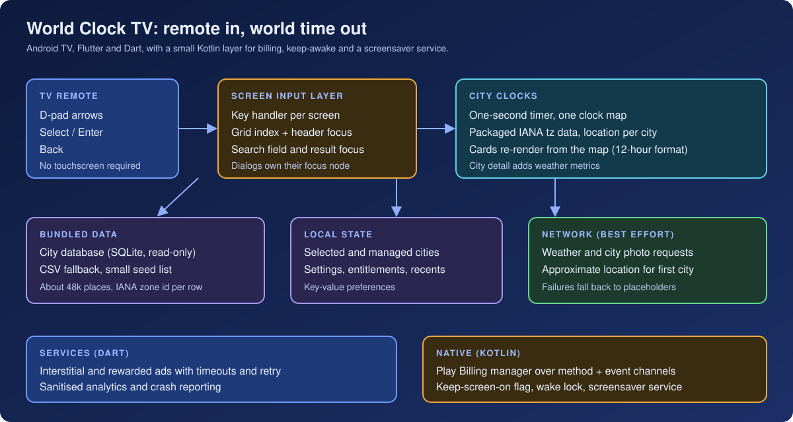
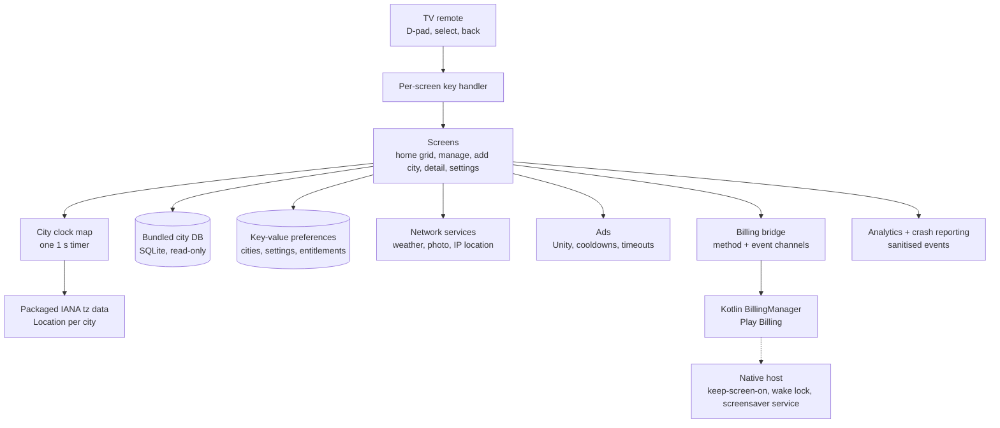

# World Clock TV

**A world clock for Android TV: a grid of live city clocks driven from the remote, with a searchable database of about 48,000 places, per-city weather and a detail view for each city.**

**Android TV** 
Flutter · Dart · Kotlin · SQLite · IANA time zone data · Riverpod · D-pad input · Firebase · Play Billing · Unity Ads

<b>Product artwork</b>: the app's banner illustration (a design asset, not a screenshot).

---

## Get the App

  

The Play listing is titled "World Clock TV" and describes a world clock for Android TV that shows global time zones. The app declares the Leanback launcher category and does not require a touchscreen.

## Product at a Glance

| | |
|---|---|
| **What it is** | A living-room world clock: a grid of city cards that each show a live time, plus a detail screen per city |
| **Platform** | Android TV only (Leanback launcher entry, TV banner, no touchscreen requirement, landscape, minimum SDK 24) |
| **Input** | Remote D-pad, select and back. Touch handlers exist but the screens are built around key events |
| **Home grid** | 3 columns by 3 rows per page, up to 25 city slots, the first two free |
| **City data** | About 48,000 bundled places across 237 country codes and 400 distinct time zone identifiers (counted from the bundled data) |
| **Clock display** | 12-hour format with seconds, English formatting; no 24-hour option was found |
| **Per-city detail** | Long date, time, UTC label, flag, weather metrics and country facts (capital, population, currency) taken from the bundled data |
| **Monetisation** | Unity Ads (interstitial and rewarded), a remove-ads purchase, per-slot and bundle purchases through a native Play Billing manager |
| **Telemetry** | Firebase Analytics and Crashlytics behind a sanitising layer |
| **Code size** | About 8,100 lines of Dart in 36 files and about 780 lines of hand-written Kotlin in 4 files |
| **Tests** | 5 unit tests in 2 files (analytics sanitiser and unlock helpers); no clock, time zone or focus tests |

## Product Artwork

**No real Android TV screenshots are included in this repository.** Both images below are production artwork or branding. Neither is a screenshot, and neither shows the app running on a device. The clock in the banner reads a fixed illustrative time.

<table>
  <tr>
    <td align="center"> <b>App icon</b> Product artwork (not a screenshot)</td>
    <td align="center"> <b>TV banner illustration</b> Product artwork with a fixed example time (not a screenshot)</td>
  </tr>
</table>

Other production images (country flags, placeholder city backgrounds and the launcher banner as shipped) are deliberately not republished. See [docs/PRIVACY_AND_SOURCE.md](docs/PRIVACY_AND_SOURCE.md).

## One Remote. Many Clocks.

  

## Key Features

- **City clock grid.** Each card shows the city, country flag, a live time with seconds, a UTC label and a weather summary. The grid pages by nine and is navigated entirely with the D-pad.
- **City search.** A text field searches the bundled city database with accent-insensitive matching, ranks exact matches first and then prefix and substring matches, and prefers capitals and larger populations.
- **Managed and visible lists.** Cities are added to a managed list and toggled on or off for the home grid, with a limit of 25 enabled.
- **City detail.** A full-screen view with the long date, time, UTC label, weather metrics and country facts.
- **First-launch city.** On the first run the app asks a public IP-location service for an approximate position and seeds the nearest city from the bundled database, falling back to a default if that fails.
- **Light and dark themes.** A setting toggles between them.
- **Offline indicator.** A "No Internet" badge appears on the home header when a connectivity check fails.
- **Ways to unlock slots.** One-time purchases for further slots and bundles, a remove-ads purchase and a restore action.

## Engineering Highlights

### Showing the right time in 400 zones without a hand-written table
- **Problem:** a world clock is only useful if each city's wall time is right, including zones with half-hour and 45-minute offsets and daylight saving rules that change over the years.
- **Approach:** every city row carries an IANA time zone identifier. The app loads the all-zones database that ships inside the `timezone` Dart package, looks up a `Location` per identifier, and builds a `TZDateTime` from the current instant in that location. The 12-hour text is then formatted from that value. No offset table is written by hand in the code path that is used at runtime.
- **Outcome:** the displayed wall time comes from rule data, not from a fixed offset. Two limits are documented honestly: the rule data is the version packaged with the app, and the "UTC +HH:MM" label is a stored string captured when the city was added (see the case study).

### A one-second clock that does not rebuild the world
- **Problem:** every card needs to tick each second on a TV, where a slow frame is visible.
- **Approach:** one periodic timer updates a single map of city clocks. After the first tick for a city, each tick adds one second to the cached value, which avoids re-resolving the zone on every tick. The home screen watches the map and a separate local-time stream for its header.
- **Outcome:** a single timer drives all cards. The trade-off is that the whole home screen rebuilds on each tick and that the cached value is not re-anchored to the system clock in the code that was read. Both are discussed in the case study.

### Driving a grid, a header, dialogs and a search field with a remote
- **Problem:** a remote cannot tap, and Flutter's geometric focus search is hard to predict in a paged grid with a header row, locked slots and a text field.
- **Approach:** the home screen owns one key handler and a small state of a slot index plus a header-focus flag. Up from the first row of the first page moves to the header (on later pages it moves to the previous page), Down from the header returns to the first row of the page, and Down from the last row of a page jumps to the next page. The add-city screen uses named focus nodes for the back button, search bar, text input and each result, and closes the on-screen keyboard explicitly so focus returns to the results. Dialogs request focus on their primary button after the first frame.
- **Outcome:** movement across pages, header and dialogs is written down in code. A shared focusable wrapper scales and outlines the focused element and reports key actions to analytics.

### Searching 48,000 places with a remote-typed query
- **Problem:** parsing a large CSV on each keystroke is too slow, and typing on a TV is slow, so results must settle quickly and tolerate accents.
- **Approach:** a build step turns the CSV into a SQLite database with normalised columns and indexes. The app copies it to local storage on first use and opens it read-only. Queries are debounced, normalised (diacritics folded, punctuation removed), capped at 30 results, de-duplicated and cached for recent queries. If the database fails, the app falls back to parsing the bundled CSV, and then to a small seed list.
- **Outcome:** search has three layers of fallback and a ranked result order.

### Not letting an ad or a network call block the clock
- **Problem:** an interstitial or a slow web request must never leave a TV stuck.
- **Approach:** ads initialise in the background with a timeout, preload with exponential backoff, enforce cooldowns, retry a failed show once and then call the completion callback anyway. Weather requests are wrapped so a failure shows a placeholder value (a dash and a help icon).
- **Outcome:** ad and network failures fall through to normal display. They are fail-open.

More: [docs/ENGINEERING_CHALLENGES.md](docs/ENGINEERING_CHALLENGES.md).

## Architecture

Details: [docs/ARCHITECTURE.md](docs/ARCHITECTURE.md).

## Technology Stack

| Layer | Technology |
|---|---|
| App | Flutter, Dart 3 |
| State | Riverpod (async notifiers, stream and future providers) |
| Navigation | `go_router` with a navigator observer for screen analytics |
| Time | `timezone` package (IANA database, all-zones variant), `intl` for formatting |
| Data | Bundled SQLite city database via `sqflite`, CSV fallback, `shared_preferences` for state |
| Networking | `dio` with explicit timeouts; connectivity checks with `connectivity_plus` |
| Native | Kotlin: `FlutterActivity` host, Play Billing client 9.1, method and event channels, keep-awake handling, a screensaver service |
| Ads | `unity_ads_plugin` (interstitial and rewarded) |
| Firebase | Core, Analytics, Crashlytics |
| Build | Java 17, minification and resource shrinking on for release, minimum SDK 24 |
| Tests | 5 unit tests |

## Documentation

| Read | For |
|---|---|
| [Technical case study](docs/TECHNICAL_CASE_STUDY.md) | End-to-end write-up with time zones and TV input first |
| [Architecture](docs/ARCHITECTURE.md) | Layers, flows and diagrams |
| [Engineering challenges](docs/ENGINEERING_CHALLENGES.md) | Problem, context, approach, trade-offs, outcome |
| [Product overview](docs/PRODUCT_OVERVIEW.md) | Screens, data and monetisation |
| [Privacy and source](docs/PRIVACY_AND_SOURCE.md) | What is and is not published, and why there are no screenshots |

## Source Code

This repository is a portfolio showcase for a production application. Production source code is maintained privately. See [RIGHTS.md](RIGHTS.md) for usage terms.
