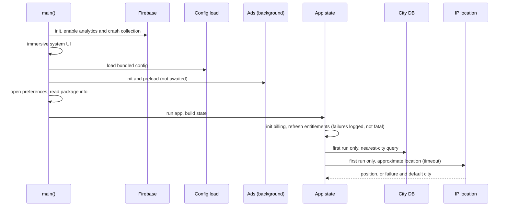
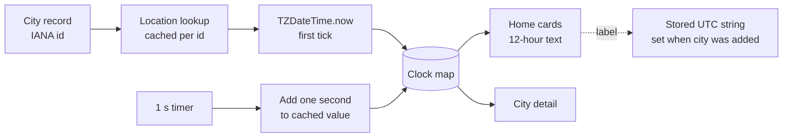
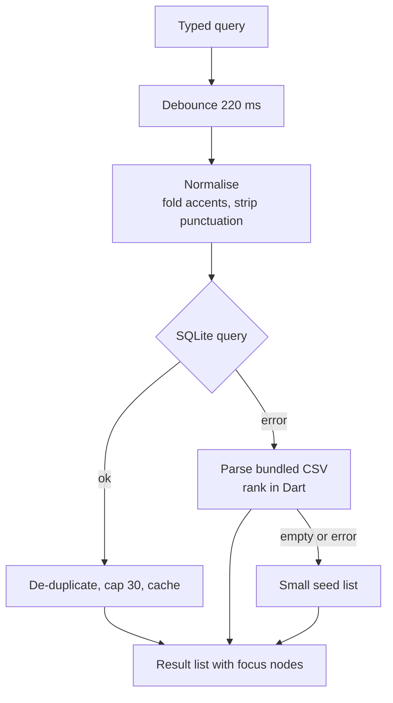
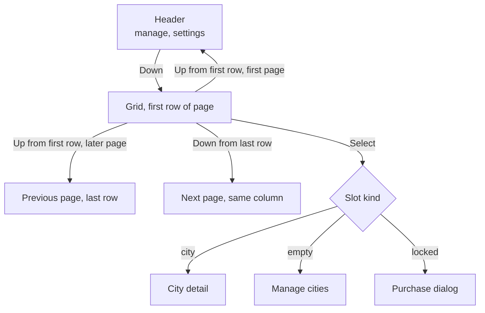

# Architecture

Conceptual view of the Android TV app. Names are descriptive, not production identifiers.

## Layers

| Layer | Responsibility |
|---|---|
| Input | Per-screen key handlers translate D-pad, select and back into grid moves, focus changes or navigation |
| Screens | Home grid, city detail, manage cities, add city, settings (plus a few registered routes that are not reached) |
| Clock state | One notifier holding a map of city clocks, updated by a one-second timer, plus a stream for the header's local time |
| Time zone data | The `timezone` package's all-zones database, one `Location` per zone identifier, cached |
| Data | Bundled SQLite city database (read-only copy in app storage), CSV fallback, key-value preferences |
| Services | Weather and photo requests, IP-based first-city lookup, connectivity check, ads, analytics, crash reporting, billing client in Dart |
| Native | Kotlin billing manager, keep-awake handling, screensaver service, activity host |

## Startup

## The clock path

The dotted edge matters: the label on screen is read from the stored city record, not from the clock map.

## Search path

## Focus model on the home screen

## Native bridge

Three method or event channels sit on the activity: one for billing calls, one for billing events (ready, disconnected, products, purchase status, success, error, cancel) and one for screensaver queries. The billing manager reconnects after a disconnect, queries product details and purchases, acknowledges purchases and caches a premium flag locally. A legacy billing channel name is also still registered.

## Boundaries and failure modes

- Ads, weather and the first-launch location lookup are best effort. Each has a timeout or a fallback, so a failure leaves the clock grid usable. On a first run the app state is still loading while the location lookup runs (up to eight seconds), so the first city can appear late; this was read from the code, not timed.
- Billing initialisation failure is caught and logged, and the app continues with locally stored entitlements.
- Search degrades from SQLite to CSV to a seed list.
- Analytics calls are wrapped so a logging failure cannot reach the UI.
